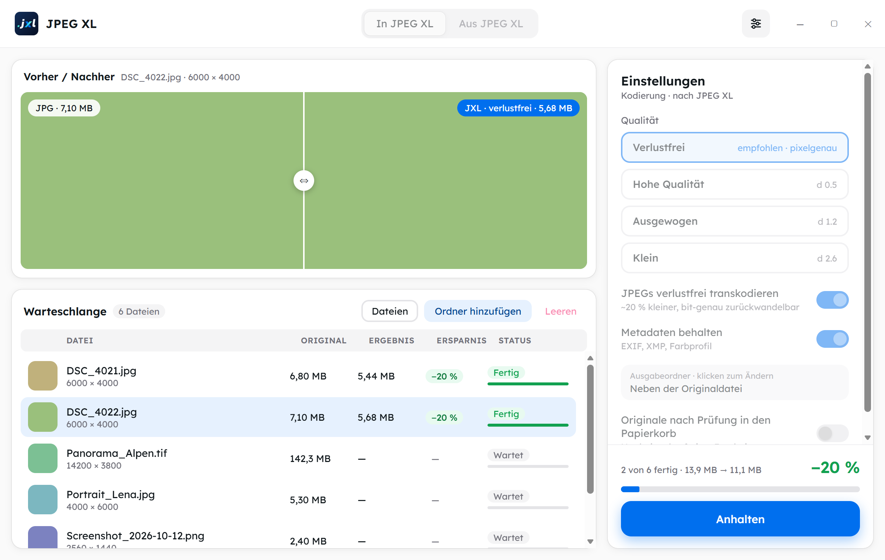
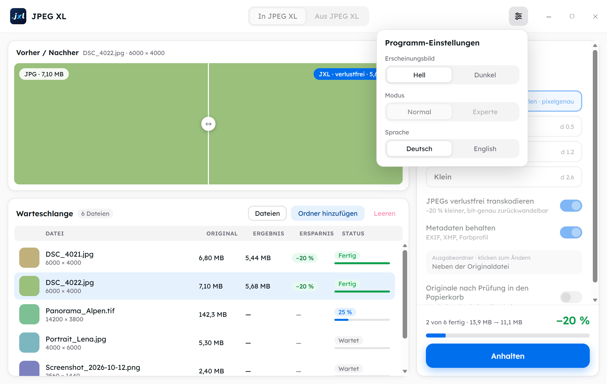

<p align="center"><a href="README.md">English</a> | <strong>Deutsch</strong></p>

<p align="center">
  
</p>

<h1 align="center">JPEG XL Converter</h1>

<p align="center">
  Windows-App zum Umwandeln von Bildern in <strong>JPEG XL</strong> und zurück –<br>
  geprüft, verlustfrei wo möglich und ohne dass je ein Bild verloren geht.<br>
  Portabel und komplett offline.
</p>

<p align="center">
  <picture>
    <source media="(prefers-color-scheme: dark)" srcset="docs/screenshots/app-de-dunkel.png">
    
  </picture>
  <br>
  <sub>Ansicht mit Beispieldaten (Demo-Modus). In der deutschen Oberfläche heißt das Fenster „JPEG XL Konverter“.</sub>
</p>

---

## Wofür?

- **Foto-Archiv verkleinern:** JPEGs werden verlustfrei nach JPEG XL umgepackt. Die Dateien werden etwa **20 % kleiner**, und jedes Original-JPEG lässt sich jederzeit **Byte für Byte** wiederherstellen.
- **Gelegentlich umwandeln:** Einzelne Bilder schnell nach JPEG XL und zurück, zum Beispiel zum Verschicken.

## Funktionen

- **Drag & Drop** von Dateien und ganzen Ordnern (inklusive Unterordnern) auf das Fenster.
- **Zwei Richtungen:** „In JPEG XL“ und „Aus JPEG XL“, jeweils mit eigener Warteschlange.
- **Qualitätsstufen:** Verlustfrei (Standard), Hohe Qualität, Ausgewogen, Klein. Im **Expertenmodus** gibt es Regler für Qualität/Distanz, Effort, JPEG-Qualität und Bittiefe.
- **Vorher/Nachher-Schieber:** Ein 100-%-Ausschnitt wird mit den aktuellen Einstellungen probehalber umgewandelt, damit du den Unterschied schon vor dem Start siehst.
- **Zurückwandeln mit „Automatisch“:** Steckt ein Original-JPEG in der `.jxl`, kommt es bit-genau zurück, sonst entsteht ein verlustfreies PNG. Außerdem stehen PNG, JPEG, WebP und TIFF zur Wahl.
- **Metadaten bleiben erhalten:** EXIF, XMP und Farbprofil werden übernommen, ebenso Erstellungs- und Änderungsdatum der Datei.
- **Schnell:** Mehrere Dateien werden parallel verarbeitet, mit Anhalten, Fortsetzen und Abbrechen. Im Test liefen 1.000 Fotos (3,55 GB) in rund 105 Sekunden durch.
- **Deutsche und englische Oberfläche**, gewählt in den Programm-Einstellungen (siehe [Programm-Einstellungen](#programm-einstellungen)).
- **Portabel:** kein Installer, alles, was die App speichert, liegt in einem Ordner `data\` neben der Exe, sie läuft also auch von einem USB-Stick (siehe [Portabel und komplett offline](#portabel-und-komplett-offline)).
- **Hell und dunkel**, Schrift Lexend, keine Netzwerkzugriffe.

## Sicherheit: Nichts geht verloren

Jede Umwandlung wird **geprüft**, bevor sie als fertig gilt:

| Fall | Prüfung |
|---|---|
| JPEG umgepackt | Original aus der `.jxl` wiederherstellen und **Byte für Byte** vergleichen |
| Verlustfrei (PNG, GIF, TIFF, WebP, BMP) | **Pixel für Pixel** mit dem Ausgangsbild vergleichen |
| Verlustbehaftet | Die Datei lässt sich fehlerfrei öffnen und die Maße stimmen |

Mit dem Schalter **„Originale nach Prüfung in den Papierkorb“** (standardmäßig aus) wandert ein Original nur dann in den Papierkorb, wenn alles erfüllt ist:

- die Prüfung ist bestanden,
- das Ergebnis ist verlustfrei,
- die Metadaten sind vollständig übernommen,
- und das Laufwerk hat einen Papierkorb, in den die Datei passt (auch Gruppenrichtlinien werden beachtet).

Auf USB-Sticks und Netzlaufwerken bleibt das Original immer liegen. **Das Programm löscht nie endgültig.** Bestehende Zieldateien werden nie überschrieben. Probleme landen in einer Protokolldatei unter `data\logs\` neben der Exe.

## Formate

| Richtung | Formate |
|---|---|
| Nach JPEG XL | JPEG, PNG, GIF, TIFF, WebP, BMP |
| Aus JPEG XL | Automatisch (Original-JPEG oder PNG), PNG, JPEG, WebP, TIFF |

### Bekannte Einschränkungen

- **EXR** wird nicht unterstützt, weil die offizielle `cjxl.exe` es nicht lesen kann.
- **CMYK-Bilder** und **Gleitkomma-TIFFs** werden abgelehnt, weil es für sie keinen verlustfreien Weg gibt.
- **Mehrseitige TIFFs, Animationen und HDR-/Gleitkomma-`.jxl`** werden umgewandelt, das Original bzw. die `.jxl` bleibt aber immer liegen.
- Ist **„Metadaten behalten“** aus, geht auch die Drehinformation verloren, und Hochkant-Fotos erscheinen dann liegend.
- Vorschaubilder von `.jxl` im Windows-Explorer liefert Microsofts **JPEG XL Image Extension** (`winget install 9mzprth5c0tb`).

## Programm-Einstellungen

Der Knopf mit den Reglern rechts oben in der Titelleiste öffnet die Programm-Einstellungen:

<p align="center">
  
</p>

- **Erscheinungsbild:** Hell oder Dunkel. Solange du nichts wählst, folgt die App der Windows-Einstellung.
- **Modus:** Normal oder Experte. Während ein Durchlauf aktiv ist, ist der Modus gesperrt.
- **Sprache:** Deutsch oder English. Beim ersten Start nimmt die App Deutsch, wenn Windows auf Deutsch steht, sonst Englisch. Danach zählt deine Wahl. Beschriftungen, Meldungen, Protokolldateien und Fenstertitel folgen der Sprache.

Deine Wahl wird in `data\settings.json` neben der Exe gespeichert.

## Portabel und komplett offline

Es gibt keinen Installer und keinen Netzwerkzugriff. Alles, was die App dauerhaft speichert, liegt in einem Ordner, **`data\` neben `JPEG XL Converter.exe`**. Er entsteht beim ersten Start und gehört nicht zum Download:

| Was | Wo |
|---|---|
| Einstellungen (Sprache, Erscheinungsbild, Modus, Qualität, …) | `data\settings.json` |
| Fenstergröße und -position | `data\window.json` |
| Protokolle | `data\logs\` |

Kopiere oder verschiebe den ganzen Programmordner, zum Beispiel auf einen USB-Stick, und deine Einstellungen kommen mit. **Im Benutzerprofil wird nichts geschrieben:** kein Ordner unter `%APPDATA%` oder `%LOCALAPPDATA%` und keine Registry-Einträge der App selbst (sie liest nur wie bisher die Papierkorb-Einstellungen).

**Was auf dem PC bleibt:**

- Benutzt wird nur der **Temp-Ordner** des PCs: Zwischendateien beim Umwandeln und die Daten der Web-Ansicht liegen in `%TEMP%\jpeg-xl-konverter\<pid>\` und werden beim Beenden gelöscht. Die Zwischendateien bleiben auf dem PC, weil sie auf einem USB-Stick deutlich langsamer wären.
- Die umgewandelten Dateien landen dort, wo du es einstellst: neben dem Original oder im gewählten Ausgabeordner.

**Schreibgeschützter Programmordner:** Liegt das Programm an einem schreibgeschützten Ort (gesperrter USB-Stick, `C:\Program Files`, Netzlaufwerk ohne Schreibrecht), hinterlässt die App trotzdem nichts im Benutzerprofil:

- Eine vorhandene `data\settings.json` wird **gelesen**, damit Sprache und Erscheinungsbild mitkommen.
- Änderungen wirken sofort, werden aber **nicht gespeichert**. Die Fensterposition wird ebenfalls nicht gespeichert.
- Protokolle landen in `%TEMP%\jpeg-xl-konverter\logs\` (sie bleiben dort, bis Windows den Temp-Ordner aufräumt; „Protokoll öffnen“ funktioniert).
- Einmal pro Start erscheint ein Hinweis: „Programmordner ist schreibgeschützt – Einstellungen werden nicht gespeichert, Protokolle liegen im Temp-Ordner.“

**WebView2:** Windows 11 bringt die WebView2-Laufzeit mit, deshalb wird keine mitgeliefert. Ihre Daten für diese App liegen in `%TEMP%\jpeg-xl-konverter\<pid>\webview` und werden beim Beenden gelöscht. Fehlt WebView2 doch, zeigt Windows seine Standardmeldung.

**Ordner der Vorversion:** Eine frühere Testversion hat ihre Daten im Benutzerprofil gespeichert. Diese Version übernimmt jene Ordner nicht und löscht sie auch nicht. Beim ersten Start gelten Standardwerte, und die Sprache kommt aus Windows. Falls die Ordner existieren, kannst du sie von Hand löschen:

- `%APPDATA%\de.bassboost1981.jpegxlkonverter`
- `%LOCALAPPDATA%\JPEG XL Konverter`
- `%LOCALAPPDATA%\de.bassboost1981.jpegxlkonverter`

## Benutzung

Voraussetzung ist **Windows 11 (x64)**. WebView2 ist bei Windows 11 bereits vorhanden.

Das Programm ist **portabel**, es gibt keinen Installer. Der Ordner `JPEG XL Converter\` enthält `JPEG XL Converter.exe`, `cjxl.exe`, `djxl.exe` und `LICENSES\`. Die drei `.exe` müssen im selben Ordner liegen. Starte `JPEG XL Converter.exe`; der Ordner `data\` entsteht daneben.

> **Bevor du ein echtes Foto-Archiv umwandelst:** Geh die Schritt-für-Schritt-Abnahme in [`docs/ABNAHME.md`](docs/ABNAHME.md) an einer **Kopie** durch, inklusive Rückwandlung mit Byte-Vergleich und USB-Stick-Test.

## Selbst bauen

Voraussetzungen: Node.js, Rust (MSVC-Toolchain) und die Visual Studio Build Tools (C++), siehe [Tauri-Voraussetzungen](https://v2.tauri.app/start/prerequisites/).

```powershell
npm install
# offizielle libjxl v0.12.0 (cjxl/djxl) laden – wird nicht eingecheckt
powershell -ExecutionPolicy Bypass -File scripts/fetch-libjxl.ps1

# Entwicklung (echte App)
npm run tauri dev
# nur die Oberfläche im Browser, mit simuliertem Hintergrund
npm run dev

# Tests
cargo test --manifest-path src-tauri/Cargo.toml
npm test

# portablen Ordner bauen → dist-portable\JPEG XL Converter\
powershell -ExecutionPolicy Bypass -File scripts/package-portable.ps1
```

Die Screenshots in dieser README stammen aus der Oberfläche im Demo-Modus. Mit `npm run dev` und einem Browser, der mit `--remote-debugging-port=9222` gestartet wurde, erzeugt `node scripts/readme-screenshots.mjs` sie neu (Aufruf im Kopf des Skripts).

## Technik

- **[Tauri 2](https://v2.tauri.app/)** mit einem Hintergrund in **Rust** (`src-tauri/src/engine/`): Einsammeln, Umwandeln, Prüfen, Papierkorb, Warteschlange und Vorschau, jeweils als eigener, getesteter Baustein.
- **Umwandlung** über die offiziellen **[libjxl](https://github.com/libjxl/libjxl)**-Programme `cjxl`/`djxl` (v0.12.0) als mitgelieferte Hilfsprogramme.
- **Oberfläche** in **React 19 + TypeScript** mit **[HeroUI v3](https://heroui.com)**, Tailwind CSS v4 und der Schrift **Lexend**. Alle Texte stehen in zwei Katalogen, `src/i18n/de.json` und `src/i18n/en.json`.

```
src/                 Oberfläche (React, HeroUI)
  i18n/              deutsche und englische Texte
src-tauri/           Tauri-App und Rust-Engine
  src/engine/        Umwandeln, Prüfen, Papierkorb, Warteschlange, Vorschau
  tests/             Rundreise-Tests mit den echten cjxl/djxl
scripts/             libjxl laden, portablen Ordner bauen, Belastungstest, README-Screenshots
docs/                Spezifikationen, Plan, Abnahme, Werkzeug-Notizen, Entwurf
```

Weitere Unterlagen: [Spezifikation](docs/superpowers/specs/2026-10-16-jpeg-xl-konverter-design.md) · [Spezifikation: zweisprachig und portabel](docs/superpowers/specs/2026-10-17-zweisprachig-portabel-design.md) · [Umsetzungsplan](docs/superpowers/plans/2026-10-16-jpeg-xl-konverter.md) · [libjxl-Notizen](docs/libjxl-notes.md) · [Abnahme](docs/ABNAHME.md)

## Lizenz

Der JPEG XL Converter steht unter der **[MIT-Lizenz](LICENSE)**, © 2026 BassBoost1981.

### Mitgelieferte Komponenten

Die mitgelieferten Komponenten behalten ihre eigenen Lizenzen. Der portable Ordner enthält ihre Lizenztexte unter `LICENSES\`:

- **libjxl** (`cjxl`/`djxl`, BSD-3-Clause), einschließlich der darin statisch eingebauten Bibliotheken (brotli, giflib, highway, libjpeg-turbo, libpng, libwebp, sjpeg, skcms, zlib)
- **libwebp** (BSD-3-Clause), für die WebP-Ausgabe
- **Lexend** (SIL Open Font License)

Tauri, React, HeroUI und Tailwind CSS stehen unter MIT- bzw. MIT/Apache-2.0-Lizenzen.
