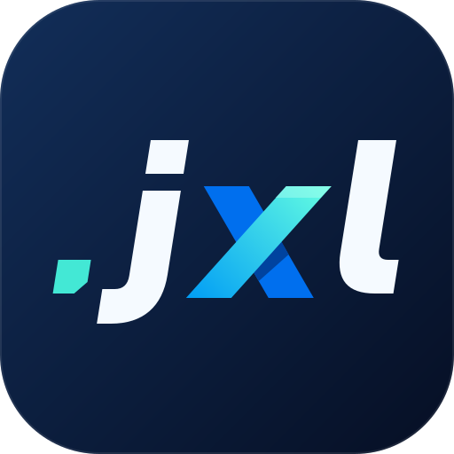
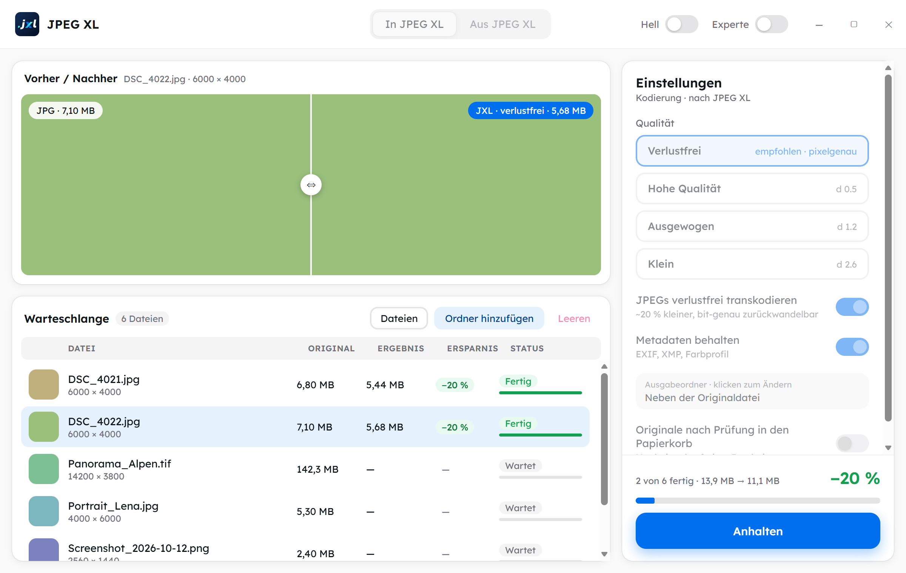

<p align="center">
  
</p>

<h1 align="center">JPEG XL Konverter</h1>

<p align="center">
  Windows-App zum Umwandeln von Bildern in <strong>JPEG XL</strong> und zurück –<br>
  geprüft, verlustfrei wo möglich und ohne dass je ein Bild verloren geht.
</p>

<p align="center">
  <picture>
    <source media="(prefers-color-scheme: dark)" srcset="docs/screenshots/app-dunkel.png">
    
  </picture>
  <br>
  <sub>Ansicht mit Beispieldaten (Demo-Modus)</sub>
</p>

---

## Wofür?

- **Foto-Archiv verkleinern:** JPEGs werden verlustfrei nach JPEG XL umgepackt. Die Dateien werden etwa **20 % kleiner**, und jedes Original-JPEG lässt sich jederzeit **Byte für Byte** wiederherstellen.
- **Gelegentlich umwandeln:** Einzelne Bilder schnell nach JPEG XL und zurück, zum Beispiel zum Verschicken.

## Funktionen

- **Drag & Drop** von Dateien und ganzen Ordnern (inklusive Unterordnern) auf das Fenster.
- **Zwei Richtungen:** „In JPEG XL“ und „Aus JPEG XL“, jeweils mit eigener Warteschlange.
- **Qualitätsstufen:** Verlustfrei (Standard), Hohe Qualität, Ausgewogen, Klein. Im **Expertenmodus** gibt es Regler für Qualität/Distanz, Effort, JPEG-Qualität und Bittiefe.
- **Vorher/Nachher-Schieber:** Ein 100-%-Ausschnitt wird mit den aktuellen Einstellungen probehalber umgewandelt, damit du den Unterschied schon vor dem Start siehst.
- **Zurückwandeln mit „Automatisch“:** Steckt ein Original-JPEG in der `.jxl`, kommt es bit-genau zurück, sonst entsteht ein verlustfreies PNG. Außerdem stehen PNG, JPEG, WebP und TIFF zur Wahl.
- **Metadaten bleiben erhalten:** EXIF, XMP und Farbprofil werden übernommen, ebenso Erstellungs- und Änderungsdatum der Datei.
- **Schnell:** Mehrere Dateien werden parallel verarbeitet, mit Anhalten, Fortsetzen und Abbrechen. Im Test liefen 1.000 Fotos (3,55 GB) in rund 105 Sekunden durch.
- **Hell und dunkel**, deutsche Oberfläche, Schrift Lexend, keine Netzwerkzugriffe.

## Sicherheit: Nichts geht verloren

Jede Umwandlung wird **geprüft**, bevor sie als fertig gilt:

| Fall | Prüfung |
|---|---|
| JPEG umgepackt | Original aus der `.jxl` wiederherstellen und **Byte für Byte** vergleichen |
| Verlustfrei (PNG, GIF, TIFF, WebP, BMP) | **Pixel für Pixel** mit dem Ausgangsbild vergleichen |
| Verlustbehaftet | Die Datei lässt sich fehlerfrei öffnen und die Maße stimmen |

Mit dem Schalter **„Originale nach Prüfung in den Papierkorb“** (standardmäßig aus) wandert ein Original nur dann in den Papierkorb, wenn alles erfüllt ist:

- die Prüfung ist bestanden,
- das Ergebnis ist verlustfrei,
- die Metadaten sind vollständig übernommen,
- und das Laufwerk hat einen Papierkorb, in den die Datei passt (auch Gruppenrichtlinien werden beachtet).

Auf USB-Sticks und Netzlaufwerken bleibt das Original immer liegen. **Das Programm löscht nie endgültig.** Bestehende Zieldateien werden nie überschrieben. Probleme landen in einer Protokolldatei unter `%LOCALAPPDATA%\JPEG XL Konverter\Protokolle\`.

## Formate

| Richtung | Formate |
|---|---|
| Nach JPEG XL | JPEG, PNG, GIF, TIFF, WebP, BMP |
| Aus JPEG XL | Automatisch (Original-JPEG oder PNG), PNG, JPEG, WebP, TIFF |

### Bekannte Einschränkungen

- **EXR** wird nicht unterstützt, weil die offizielle `cjxl.exe` es nicht lesen kann.
- **CMYK-Bilder** und **Gleitkomma-TIFFs** werden abgelehnt, weil es für sie keinen verlustfreien Weg gibt.
- **Mehrseitige TIFFs, Animationen und HDR-/Gleitkomma-`.jxl`** werden umgewandelt, das Original bzw. die `.jxl` bleibt aber immer liegen.
- Ist **„Metadaten behalten“** aus, geht auch die Drehinformation verloren, und Hochkant-Fotos erscheinen dann liegend.
- Vorschaubilder von `.jxl` im Windows-Explorer liefert Microsofts **JPEG XL Image Extension** (`winget install 9mzprth5c0tb`).

## Benutzung

Voraussetzung ist **Windows 11 (x64)**. WebView2 ist bei Windows 11 bereits vorhanden.

Das Programm ist **portabel**, es gibt keinen Installer. Der Ordner `JPEG XL Konverter\` enthält `JPEG XL Konverter.exe`, `cjxl.exe`, `djxl.exe` und `LICENSES\`. Die drei `.exe` müssen im selben Ordner liegen.

> **Bevor du ein echtes Foto-Archiv umwandelst:** Geh die Schritt-für-Schritt-Abnahme in [`docs/ABNAHME.md`](docs/ABNAHME.md) an einer **Kopie** durch, inklusive Rückwandlung mit Byte-Vergleich und USB-Stick-Test.

## Selbst bauen

Voraussetzungen: Node.js, Rust (MSVC-Toolchain) und die Visual Studio Build Tools (C++), siehe [Tauri-Voraussetzungen](https://v2.tauri.app/start/prerequisites/).

```powershell
npm install
# offizielle libjxl v0.12.0 (cjxl/djxl) laden – wird nicht eingecheckt
powershell -ExecutionPolicy Bypass -File scripts/fetch-libjxl.ps1

# Entwicklung (echte App)
npm run tauri dev
# nur die Oberfläche im Browser, mit simuliertem Hintergrund
npm run dev

# Tests
cargo test --manifest-path src-tauri/Cargo.toml
npm test

# portablen Ordner bauen → dist-portable\JPEG XL Konverter\
powershell -ExecutionPolicy Bypass -File scripts/package-portable.ps1
```

## Technik

- **[Tauri 2](https://v2.tauri.app/)** mit einem Hintergrund in **Rust** (`src-tauri/src/engine/`): Einsammeln, Umwandeln, Prüfen, Papierkorb, Warteschlange und Vorschau, jeweils als eigener, getesteter Baustein.
- **Umwandlung** über die offiziellen **[libjxl](https://github.com/libjxl/libjxl)**-Programme `cjxl`/`djxl` (v0.12.0) als mitgelieferte Hilfsprogramme.
- **Oberfläche** in **React 19 + TypeScript** mit **[HeroUI v3](https://heroui.com)**, Tailwind CSS v4 und der Schrift **Lexend**.

```
src/                 Oberfläche (React, HeroUI)
src-tauri/           Tauri-App und Rust-Engine
  src/engine/        Umwandeln, Prüfen, Papierkorb, Warteschlange, Vorschau
  tests/             Rundreise-Tests mit den echten cjxl/djxl
scripts/             libjxl laden, portablen Ordner bauen, Belastungstest
docs/                Spezifikation, Plan, Abnahme, Werkzeug-Notizen, Entwurf
```

Weitere Unterlagen: [Spezifikation](docs/superpowers/specs/2026-10-16-jpeg-xl-konverter-design.md) · [Umsetzungsplan](docs/superpowers/plans/2026-10-16-jpeg-xl-konverter.md) · [libjxl-Notizen](docs/libjxl-notes.md) · [Abnahme](docs/ABNAHME.md)

## Lizenz

Der JPEG XL Konverter steht unter der **[MIT-Lizenz](LICENSE)**, © 2026 BassBoost1981.

### Mitgelieferte Komponenten

Die mitgelieferten Komponenten behalten ihre eigenen Lizenzen. Der portable Ordner enthält ihre Lizenztexte unter `LICENSES\`:

- **libjxl** (`cjxl`/`djxl`, BSD-3-Clause), einschließlich der darin statisch eingebauten Bibliotheken (brotli, giflib, highway, libjpeg-turbo, libpng, libwebp, sjpeg, skcms, zlib)
- **libwebp** (BSD-3-Clause), für die WebP-Ausgabe
- **Lexend** (SIL Open Font License)

Tauri, React, HeroUI und Tailwind CSS stehen unter MIT- bzw. MIT/Apache-2.0-Lizenzen.
