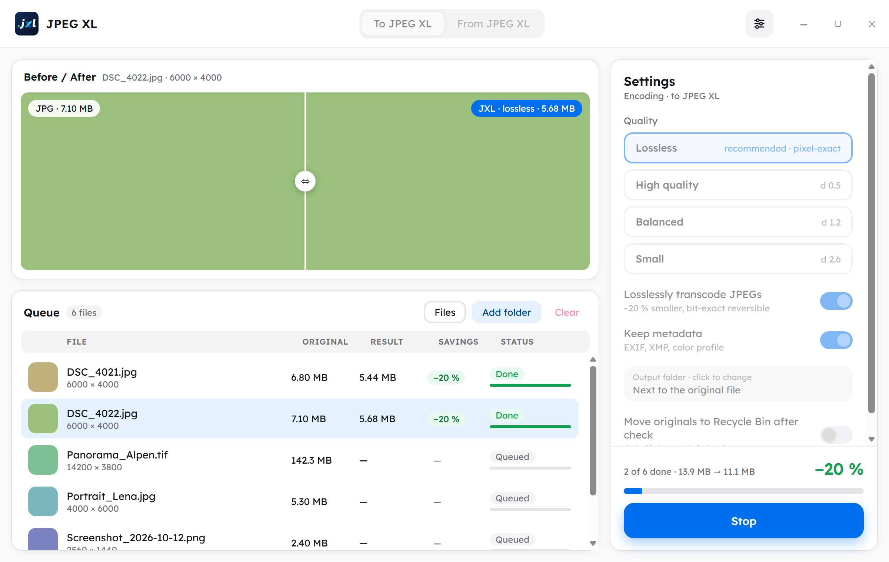
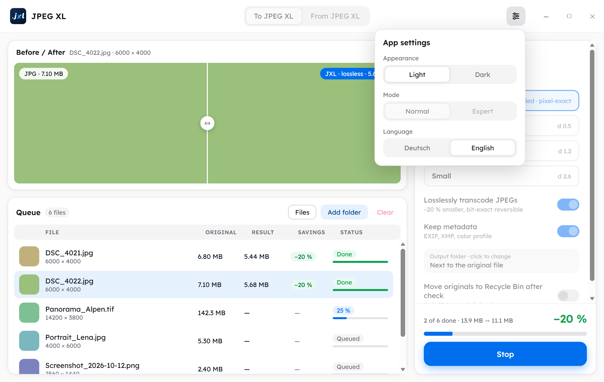

<p align="center"><strong>English</strong> | <a href="README.de.md">Deutsch</a></p>

<p align="center">
  
</p>

<h1 align="center">JPEG XL Converter</h1>

<p align="center">
  Windows app to convert images to <strong>JPEG XL</strong> and back –<br>
  checked, lossless where possible, and no image is ever lost.<br>
  Portable and fully offline.
</p>

<p align="center">
  <picture>
    <source media="(prefers-color-scheme: dark)" srcset="docs/screenshots/app-en-dark.png">
    
  </picture>
  <br>
  <sub>View with sample data (demo mode)</sub>
</p>

---

## What is it for?

- **Shrinking a photo archive:** JPEGs are repacked losslessly to JPEG XL. The files get about **20 % smaller**, and every original JPEG can be restored **byte for byte** at any time.
- **Converting now and then:** Quickly turn single images into JPEG XL and back, for example to send them.

## Features

- **Drag and drop** of files and whole folders (including subfolders) onto the window.
- **Two directions:** "To JPEG XL" and "From JPEG XL", each with its own queue.
- **Quality levels:** Lossless (default), High quality, Balanced, Small. **Expert mode** adds sliders for quality/distance, effort, JPEG quality and bit depth.
- **Before/after slider:** A 100 % crop is converted as a trial with the current settings, so you see the difference before you start.
- **Converting back with "Automatic":** If an original JPEG is inside the `.jxl`, it comes back bit-exact, otherwise you get a lossless PNG. PNG, JPEG, WebP and TIFF are available as well.
- **Metadata is kept:** EXIF, XMP and color profile are carried over, as are the file's creation and modification dates.
- **Fast:** Several files are processed in parallel, with pause, resume and cancel. In a test, 1,000 photos (3.55 GB) went through in about 105 seconds.
- **German and English interface**, chosen in the app settings (see [Settings](#settings)).
- **Portable:** no installer, everything the app saves lives in a `data\` folder next to the exe, so it runs from a USB stick (see [Portable and fully offline](#portable-and-fully-offline)).
- **Light and dark** appearance, Lexend font, no network access.

## Safety: nothing gets lost

Every conversion is **checked** before it counts as done:

| Case | Check |
|---|---|
| JPEG repacked | Restore the original from the `.jxl` and compare it **byte for byte** |
| Lossless (PNG, GIF, TIFF, WebP, BMP) | Compare **pixel by pixel** with the source image |
| Lossy | The file opens without errors and the dimensions match |

With the switch **"Move originals to Recycle Bin after check"** (off by default), an original only goes to the Recycle Bin if all of this holds:

- the check passed,
- the result is lossless,
- the metadata was carried over completely,
- and the drive has a Recycle Bin the file fits into (group policies are respected, too).

On USB sticks and network drives the original always stays. **The app never deletes anything permanently.** Existing target files are never overwritten. Problems are written to a log file in `data\logs\` next to the exe.

## Formats

| Direction | Formats |
|---|---|
| To JPEG XL | JPEG, PNG, GIF, TIFF, WebP, BMP |
| From JPEG XL | Automatic (original JPEG or PNG), PNG, JPEG, WebP, TIFF |

### Known limitations

- **EXR** is not supported because the official `cjxl.exe` cannot read it.
- **CMYK images** and **floating-point TIFFs** are rejected because there is no lossless path for them.
- **Multi-page TIFFs, animations and HDR/floating-point `.jxl`** are converted, but the original or the `.jxl` always stays.
- If **"Keep metadata"** is off, the rotation information is lost too, and portrait photos then show up lying on their side.
- Thumbnails of `.jxl` files in Windows Explorer come from Microsoft's **JPEG XL Image Extension** (`winget install 9mzprth5c0tb`).

## Settings

The sliders button at the top right of the title bar opens the app settings:

<p align="center">
  
</p>

- **Appearance:** Light or Dark. Until you choose, the app follows the Windows setting.
- **Mode:** Normal or Expert. The mode is locked while a run is active.
- **Language:** Deutsch or English. On the first start the app uses German if Windows is set to German and English otherwise. After you choose, your choice counts. Labels, messages, log files and the window title follow the language.

Your choices are saved in `data\settings.json` next to the exe.

## Portable and fully offline

There is no installer and no network access. Everything the app saves permanently lives in one folder, **`data\` next to `JPEG XL Converter.exe`**. It is created on the first start and is not part of the download:

| What | Where |
|---|---|
| Settings (language, appearance, mode, quality, …) | `data\settings.json` |
| Window size and position | `data\window.json` |
| Logs | `data\logs\` |

Copy or move the whole app folder, for example to a USB stick, and your settings come along. **Nothing is written to your user profile:** no folder under `%APPDATA%` or `%LOCALAPPDATA%`, and no registry entries from the app itself (it only reads the Recycle Bin settings, as before).

**What stays on the PC:**

- Only the PC's **temp folder** is used: intermediate files while converting and the web view's data live in `%TEMP%\jpeg-xl-konverter\<pid>\` and are removed when you close the app. Intermediate files stay on the PC because they would be much slower on a USB stick.
- The converted files land where you set it: next to the original or in the output folder you chose.

**Read-only app folder:** If the app sits in a write-protected place (locked USB stick, `C:\Program Files`, a network drive without write permission), it still leaves nothing in your user profile:

- An existing `data\settings.json` is **read**, so language and appearance come along.
- Changes take effect right away but are **not saved**. The window position is not saved either.
- Logs go to `%TEMP%\jpeg-xl-konverter\logs\` (they stay there until Windows cleans the temp folder; "Open log" works).
- Once per start, a notice reads: "App folder is read-only – settings are not saved, logs go to the temp folder."

**WebView2:** Windows 11 ships the WebView2 runtime, so none is bundled. Its data for this app goes to `%TEMP%\jpeg-xl-konverter\<pid>\webview` and is removed on exit. If WebView2 is missing anyway, Windows shows its standard message.

**Folders of the previous version:** An earlier test version saved its data in your user profile. This version does not pick up those folders and does not delete them. On the first start the defaults apply and the language comes from Windows. If the folders exist, you can delete them by hand:

- `%APPDATA%\de.bassboost1981.jpegxlkonverter`
- `%LOCALAPPDATA%\JPEG XL Konverter`
- `%LOCALAPPDATA%\de.bassboost1981.jpegxlkonverter`

## Usage

The prerequisite is **Windows 11 (x64)**. WebView2 is already part of Windows 11.

The app is **portable**, there is no installer. The folder `JPEG XL Converter\` contains `JPEG XL Converter.exe`, `cjxl.exe`, `djxl.exe` and `LICENSES\`. The three `.exe` files must stay in the same folder. Start `JPEG XL Converter.exe`; the `data\` folder appears next to it.

> **Before you convert a real photo archive:** Work through the step-by-step acceptance in [`docs/ACCEPTANCE.md`](docs/ACCEPTANCE.md) on a **copy**, including converting back with a byte comparison and the USB stick test.

## Build it yourself

Prerequisites: Node.js, Rust (MSVC toolchain) and the Visual Studio Build Tools (C++), see the [Tauri prerequisites](https://v2.tauri.app/start/prerequisites/).

```powershell
npm install
# fetch the official libjxl v0.12.0 (cjxl/djxl) – not checked in
powershell -ExecutionPolicy Bypass -File scripts/fetch-libjxl.ps1

# development (real app)
npm run tauri dev
# UI only, in the browser, with a simulated backend
npm run dev

# tests
cargo test --manifest-path src-tauri/Cargo.toml
npm test

# build the portable folder → dist-portable\JPEG XL Converter\
powershell -ExecutionPolicy Bypass -File scripts/package-portable.ps1
```

The screenshots in this README come from the UI in demo mode. With `npm run dev` and a browser started with `--remote-debugging-port=9222`, `node scripts/readme-screenshots.mjs` regenerates them (usage in the header of the script).

## Technology

- **[Tauri 2](https://v2.tauri.app/)** with a backend in **Rust** (`src-tauri/src/engine/`): collecting, converting, checking, Recycle Bin, queue and preview, each as its own tested building block.
- **Conversion** through the official **[libjxl](https://github.com/libjxl/libjxl)** programs `cjxl`/`djxl` (v0.12.0), shipped as helper programs.
- **Interface** in **React 19 + TypeScript** with **[HeroUI v3](https://heroui.com)**, Tailwind CSS v4 and the **Lexend** font. All texts come from two catalogs, `src/i18n/de.json` and `src/i18n/en.json`.

```
src/                 UI (React, HeroUI)
  i18n/              German and English texts
src-tauri/           Tauri app and Rust engine
  src/engine/        Convert, check, Recycle Bin, queue, preview
  tests/             Round-trip tests with the real cjxl/djxl
scripts/             fetch libjxl, build the portable folder, stress test, README screenshots
docs/                Specifications, plan, acceptance, tool notes, design
```

More documents (the specifications, plan and tool notes are in German): [Specification](docs/superpowers/specs/2026-10-16-jpeg-xl-konverter-design.md) · [Specification: bilingual and portable](docs/superpowers/specs/2026-10-17-zweisprachig-portabel-design.md) · [Implementation plan](docs/superpowers/plans/2026-10-16-jpeg-xl-konverter.md) · [libjxl notes](docs/libjxl-notes.md) · [Acceptance](docs/ACCEPTANCE.md)

## License

JPEG XL Converter is released under the **[MIT License](LICENSE)**, © 2026 BassBoost1981.

### Bundled components

The bundled components keep their own licenses. The portable folder contains their license texts under `LICENSES\`:

- **libjxl** (`cjxl`/`djxl`, BSD-3-Clause), including the libraries built statically into them (brotli, giflib, highway, libjpeg-turbo, libpng, libwebp, sjpeg, skcms, zlib)
- **libwebp** (BSD-3-Clause), for the WebP output
- **Lexend** (SIL Open Font License)

Tauri, React, HeroUI and Tailwind CSS are released under MIT or MIT/Apache-2.0 licenses.
